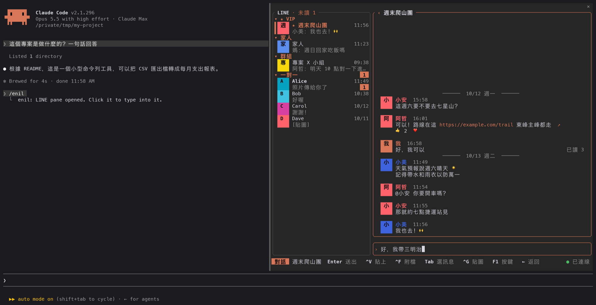
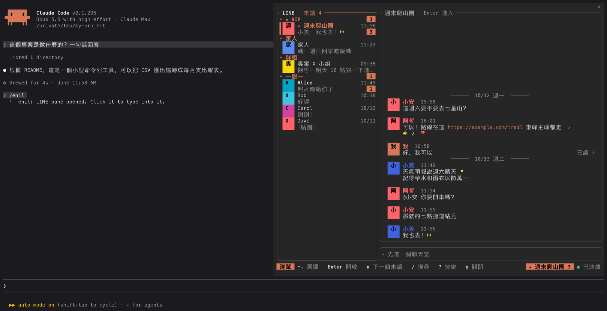
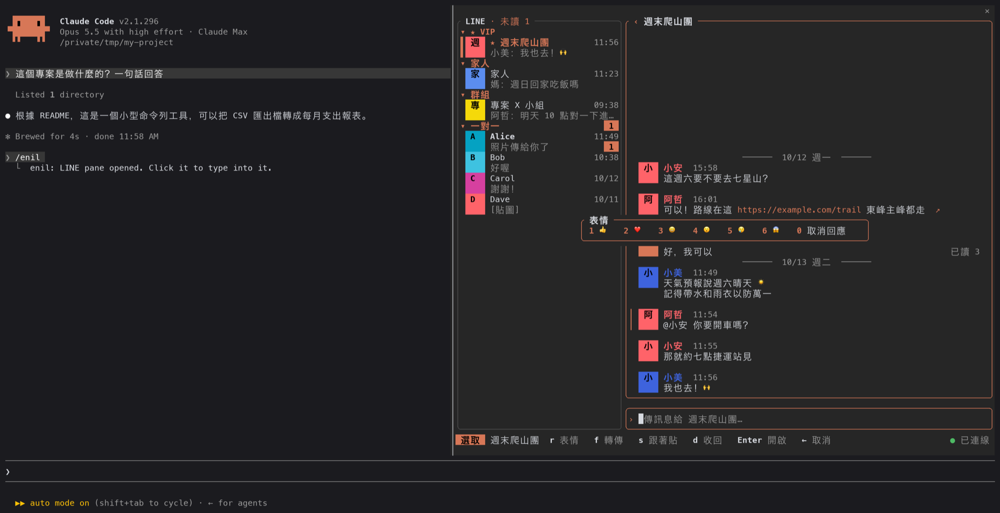

# enil for Claude Code

在 [Claude Code](https://claude.com/claude-code) 裡用 LINE：[enil](https://github.com/Unayung/enil) 終端機 TUI 的移植，做成一個 Claude Code mod，開在 Claude Code 的面板裡。



| 清單與預覽 | 選一則訊息按 r 回表情 |
|---|---|
|  |  |

<sub>截圖是真的 Claude Code 跑這個 mod（`/enil` 打開的面板停在右邊），聊天內容是假的 daemon 給的範例資料。大頭貼在這裡是名字的第一個字；終端機支援 kitty 圖片協定時會是照片。</sub>


- 聊天室清單：分區（★ VIP → 自己的分類 → 群組 → 一對一）、未讀數、預覽，游標停下來右邊直接預覽
- 對話：日期線、發話者顏色、大頭貼、圖片、貼圖、已讀、@你、表情統計、連結 ↗
- 回覆、附檔（路徑補完、剪貼簿、拖檔案進來）、貼圖選單、@ 提及
- 選一則訊息後：表情回應、收回、轉傳、跟著貼、開附件（圖片在面板裡看、語音直接播）
- 搜尋全部聊天室與好友、搜尋訊息存檔（比 LINE 保留的兩週更早的也找得到）
- VIP、分類、收合狀態、最近的貼圖跟 TUI 共用同一份（存在 daemon 那台）
- 主題：跟著 Claude Code、Omarchy、終端機，加上 15 個內建主題與 slk 格式的自訂主題
- 新訊息的 toast、桌面通知、狀態列的未讀數

## 需要什麼

這個 mod 不碰 LINE 協定。它是 [enil](https://github.com/Unayung/enil) daemon 的另一個消費者，跟 TUI 走同一個 unix socket。

| 東西 | 在哪台 | 用途 |
|---|---|---|
| Claude Code 2.1.296 以上 | 你用 Claude Code 的那台 | 跑這個 mod |
| [enil](https://github.com/Unayung/enil) daemon，已登入 | 本機或別台 | LINE 本身 |
| Node.js | daemon 那台 | mod 用 `node -e` 跟 socket 講話（daemon 本來就需要 node） |
| ImageMagick（`magick`） | daemon 那台 | 大頭貼、照片、貼圖轉成 PNG；沒有的話顯示文字標示 |
| ssh 免密碼登入 | daemon 在別台時 | `ssh <主機> true` 不必輸入密碼就能連上 |
| kitty 圖片協定的終端機（kitty、Ghostty、WezTerm） | 你這台 | 畫圖；其他終端機顯示文字標示 |

daemon 只能在一台機器上跑（LINE 的登入會把另一台踢掉），所以常見的用法是 daemon 留在家裡那台，筆電上的 Claude Code 透過 ssh 用它。

## 安裝

```sh
claude plugin marketplace add Unayung/cc-mods-enil
claude plugin install enil@cc-mods-enil
```

或在 Claude Code 的提示字元輸入：

```
/plugin install enil --marketplace Unayung/cc-mods-enil
```

daemon 在別台的話，到 `/config` 把 **Daemon host** 設成那台的 ssh 主機名稱（`~/.ssh/config` 裡的 Host），然後開一個新的 session。

## 使用

```
/enil          打開 LINE 面板
/enil close    關掉
```

**先用滑鼠點一下面板**：Claude Code 的規矩是點過才把鍵盤交給面板。按鍵跟 TUI 一樣，面板裡按 `?`（聊天時 `F1`）看完整說明。

| 鍵 | 做什麼 |
|---|---|
| ↑ ↓ j k、Enter | 選聊天室、打開 |
| ←（輸入框空的時候）、點標題的 ‹ | 回清單 |
| Tab ⇧Tab | 選一則訊息，再按 r 表情、d 收回（按兩次）、f 轉傳、s 跟著貼、Enter 開啟 |
| / 、Ctrl-S | 搜尋聊天室、搜尋訊息 |
| Ctrl-G、Ctrl-F、Ctrl-V | 貼圖、附檔、貼上剪貼簿 |
| n、Ctrl-N | 下一個有未讀的聊天室 |
| Ctrl-P、c 或 Ctrl-T | VIP、分類 |
| Ctrl-B、Ctrl-Y | 清單寬窄、換主題 |
| q | 關掉面板 |

## 讓 Claude 幫你擬訊息

跟 Claude 說「幫我跟小安說 週六改成八點集合」，它會用這個 mod 的 `draft` 工具：打開 LINE 面板、切到那個聊天室、把訊息放進輸入框。**它不會送出**，你看過、要改就改，在面板裡按 Enter 才送。

- 名字對到好幾個聊天室時，Claude 會列出來問你是哪一個
- 工具只會擬稿：送出一定是你在面板裡按的 Enter

## 設定

`/config` 裡的 enil：

| 選項 | 值 | 預設 |
|---|---|---|
| Daemon host | daemon 那台的 ssh 主機；空白＝這台 | 空白 |
| Toast on new messages | `all`、`vip`、`off` | `vip` |
| Toast seconds | 秒數 | `6` |
| Desktop notification | `all`、`vip`、`off`（走你在 Claude Code 設定的通知管道；開好幾個 session 也只發一次） | `vip` |
| Unread in status line | `statusline`、`off` | `statusline` |
| Images | `on`、`off` | `on` |

## 跟 TUI 不一樣的地方

都是 Claude Code 面板的限制：

- **Esc 送不進面板。** Claude Code 把 Esc 留給自己（交還鍵盤），面板收不到。回清單用 ←（輸入框空的時候）或點標題的 ‹；浮層用 `q` 或在空的輸入欄按 Backspace 關掉。
- **滑鼠滾輪不會捲訊息。** 用 PgUp／PgDn。
- **沒有真的游標**，畫成反白的一格，所以輸入法的候選字視窗不會跟著走。
- **有些 Ctrl 鍵可能被 Claude Code 先拿走**（Ctrl-B、Ctrl-T、Ctrl-G、Ctrl-S 等，看你的按鍵設定）。
- **動態貼圖只顯示第一格。**
- **在 tmux、zellij、herdr 這類多工器裡看不到圖**：Claude Code 偵測不到圖片支援。如果多工器會把 kitty 圖片轉送出去，在 `~/.claude/settings.json` 強制打開：

  ```json
  { "env": { "CLAUDE_CODE_FORCE_TERMINAL_IMAGES": "1" } }
  ```

## 怎麼運作

Mod 的環境沒有 socket，只能起行程。每個請求起一次 `node -e <bridge> req`（daemon 在別台時前面加 ssh），把一行 JSON 交給 daemon 的 unix socket，印出第一行回應就結束；推送用同一個 bridge 的 `sub` 模式常駐。ssh 用 ControlMaster 共用一條連線，睡眠醒來時卡住的共用連線 20 秒內判死、自動重開。

畫面是一個 Client（`hooks/app.tsx`），照 TUI 的做法畫進一張格子再交出去；圖片在 daemon 那台用 ImageMagick 轉成 PNG，由 hooks 模組疊在畫面算好的位置上。VIP、分類、收合、最近的貼圖直接讀寫 daemon state 目錄裡 TUI 用的那幾個檔。

這個 mod 不在 system prompt 裡加任何東西。它給模型一個工具 `draft`（見上面「讓 Claude 幫你擬訊息」），只能把字放進面板的輸入框，不能送出、也讀不到你的訊息；你的 LINE 訊息不會進到對話裡。

## 用之前要知道

跟 enil 本身一樣：這不是官方支援的用法，協定是逆向來的；訊息會真的送到真人手上。細節看 [enil 的 README](https://github.com/Unayung/enil#用之前要知道)。

## 移除

```sh
claude plugin uninstall enil@cc-mods-enil
claude plugin marketplace remove cc-mods-enil
```

附件下載的快取在 `~/Library/Caches/enil-mod/`（macOS）或 `~/.cache/enil-mod/`（Linux）。

## 開發

```sh
claude --plugin-dir plugins/enil     # 從這份 checkout 載入
claude plugin validate plugins/enil
claude plugin test plugins/enil      # 測試用假的 daemon，不會連到 LINE
```

## 更新紀錄

### 0.2.0

- **讓 Claude 幫你擬訊息**：新的 `draft` 工具。跟 Claude 說「幫我跟某某說…」，它會打開 LINE 面板、切到那個聊天室、把字放進輸入框，由你按 Enter 送出（Claude 自己不會送）。名字對到好幾個人時會先問你是哪一個。
- 修：面板剛打開、還沒按過任何鍵時，每次重畫都會把畫面狀態重設（例如剛放進去的擬稿會不見）。
- 修：打字時狀態列還一直顯示「點一下面板開始操作」。
- 修：空的輸入框，游標蓋掉提示字的第一個字。

### 0.1.0

- 第一版：enil TUI 的清單、對話、回覆、貼圖、搜尋、VIP、分類、主題，在 Claude Code 面板裡。

## License

MIT
